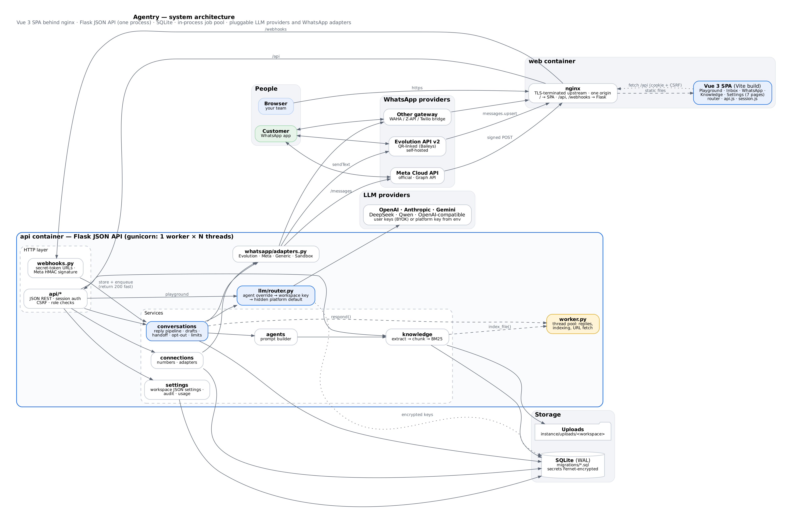
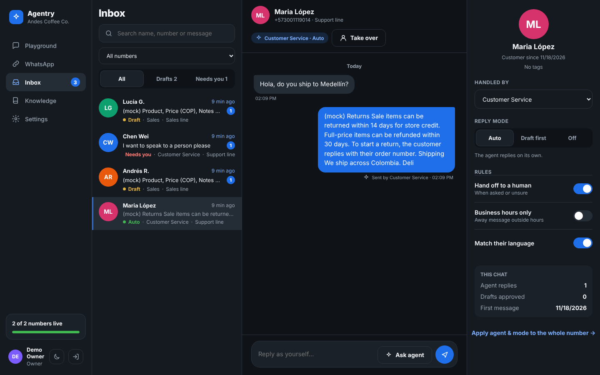
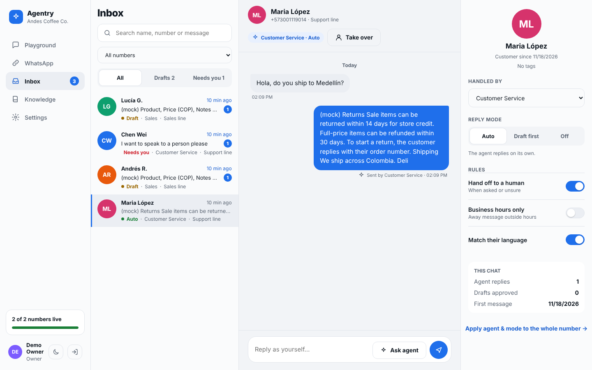
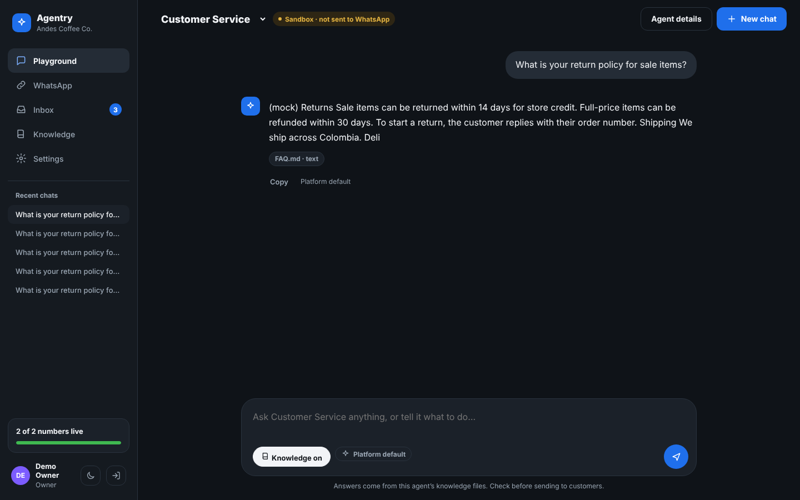
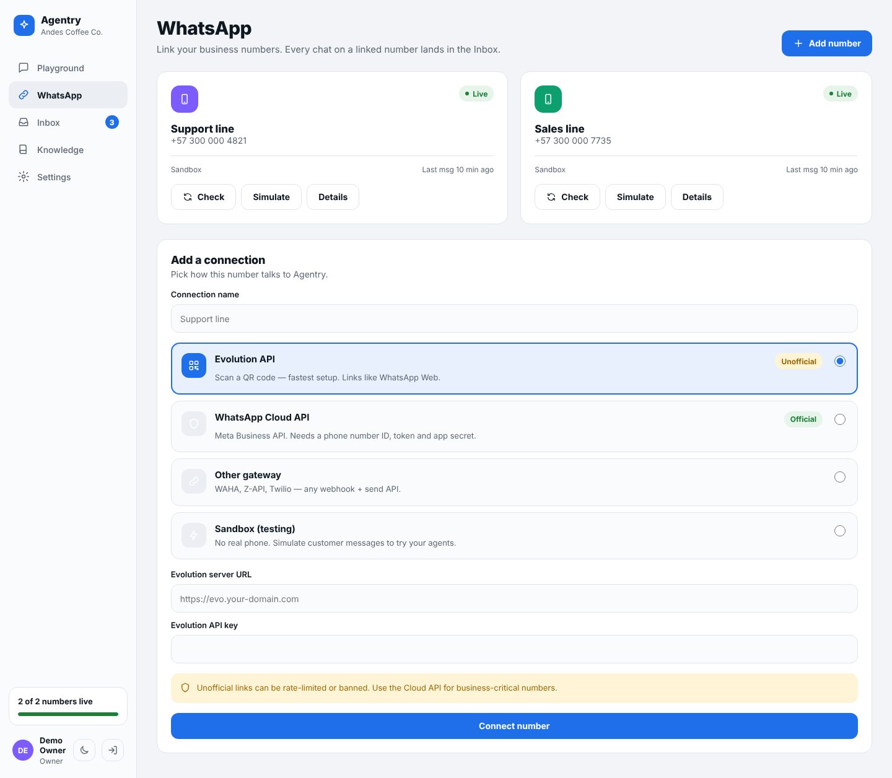

# Agentry

Build AI agents (Customer Service, Project Manager, Marketing, Sales, or your own) that answer your
**WhatsApp** chats using **your own documents**, with the **LLM of your choice**.



Two independent apps:

| Part | Tech | Folder | Dev URL |
|---|---|---|---|
| **Frontend** | Vue 3 + Vite + Vue Router (no other runtime dependencies) | `frontend/` | http://localhost:5173 |
| **API** | Python 3.9–3.13 (3.11+ recommended), Flask 3 (JSON only), SQLite | `app/` | http://localhost:5001 |

In production, nginx serves the built Vue app and forwards `/api` and `/webhooks` to Flask, so the
browser and WhatsApp providers see one origin.

| Screen | What it does |
|---|---|
| **Playground** | Full-screen chat with any agent to test answers (never sent to WhatsApp). |
| **WhatsApp** | Link numbers via Evolution API (QR), Meta Cloud API (official), a generic gateway, or a Sandbox. |
| **Inbox** | Every WhatsApp chat. Choose the agent per chat and the reply mode (**Auto / Draft first / Off**); approve drafts; take over. |
| **Knowledge** | Upload PDF/DOCX/XLSX/CSV/TXT/MD, add a web page or Q&A, assign files to agents, edit agent instructions. |
| **Settings** | General, Models & API keys, Agents, WhatsApp, Team, Billing & usage, Security. |

A hidden **platform default model** (set by environment variables) answers when a workspace has no
key of its own. Users only ever see "Platform default".

## Run with Docker (production)

Needs Docker with Compose v2, and a domain pointing at the server.

```bash
git clone https://github.com/<you>/agentry.git && cd agentry
scripts/init-env.sh agentry.example.com     # creates .env with fresh secrets (or: cp .env.example .env and edit)
docker compose up -d --build                # web + api; data in the agentry-data volume
curl http://127.0.0.1:8090/healthz          # {"status":"ok"}
```

The app listens on `127.0.0.1:8090`. Put HTTPS in front of it. With Caddy that's
`agentry.example.com { reverse_proxy 127.0.0.1:8090 }`. Then open the site and create your workspace.

The full guide, including Evolution API, backups and updates, is [docs/DEPLOY_VPS.md](docs/DEPLOY_VPS.md).

## Local development

Needs **Python 3.9+** (`python3 --version`) and **Node 20+** (`node --version`).

```bash
make venv                       # creates .venv with python3; make uses it automatically
make install                    # pip install -r requirements-dev.txt  +  cd frontend && npm install
make dev                        # API on :5001 + Vue on :5173 → open http://localhost:5173
make doctor                     # (second terminal) checks every link and tells you what's missing
```

No `.env` is needed for local development. (`.env.example` is set up for production: if you copy it for
local use, set `SESSION_COOKIE_SECURE=false`, `PUBLIC_BASE_URL=http://localhost:5001` and
`FRONTEND_URL=http://localhost:5173`, or Safari won't keep you logged in.)

Open the app and **create your workspace** (the first account is the owner). There is no demo data.

### Finish setup

A new workspace has **no AI model and no WhatsApp number**. The sidebar shows a **Finish setup** card until both exist.

1. **AI model:** **Settings › Models & API keys** → open a provider (OpenAI, DeepSeek, Anthropic, Gemini, Qwen…)
   → paste the key → **Save**. The first key is used automatically, and the Playground answers for real.
   (Or set a hidden default for every workspace: `PLATFORM_LLM_PROVIDER`, `_MODEL` and `_API_KEY` in `.env`, then restart the API.)
2. **WhatsApp:** **WhatsApp › Connect a number** → Evolution API (run one with `docker compose up evolution`,
   then use `http://localhost:8080` and its API key) → scan the QR with the phone. Evolution must be able to
   reach `PUBLIC_BASE_URL` for incoming messages: on a laptop, expose port 5001 with a tunnel (ngrok, cloudflared)
   and set `PUBLIC_BASE_URL` to that URL. See [docs/WHATSAPP_INTEGRATION.md](docs/WHATSAPP_INTEGRATION.md).

**Testing without a phone (developers only):** set `ENABLE_TEST_TOOLS=true` in `.env` to get Sandbox numbers,
the **Simulate** button and the placeholder model. Never enable it on a public server.

## Commands

| Command | Purpose |
|---|---|
| `make dev` | API + Vue dev servers together (`make api` / `make web` separately) |
| `make test` | 35 backend tests (pytest, offline) + frontend static checks |
| `make check` | Full Vue production build (`npm run build`) |
| `make api-docs` | Regenerate the API docs (backend, frontend, OpenAPI) from the code |
| `make doctor` | Check API, web, proxy, database, AI model and WhatsApp; prints how to fix each problem |
| `make docker` | `docker compose up -d --build` (web on 127.0.0.1:8090 + API; `--profile evolution` adds Evolution API) |
| `make purge` | Apply data-retention settings (schedule nightly) |
| `flask --app wsgi reindex` | Re-index all knowledge files |
| `flask --app wsgi create-owner --email … --password …` | First user when registration is closed |

## Documentation

Start with **[docs/HANDOVER.md](docs/HANDOVER.md)**: the first-day checklist for a new maintainer.

| Doc | Read it when… |
|---|---|
| [ARCHITECTURE.md](docs/ARCHITECTURE.md) | You need the mental model: components, request flows, design decisions |
| [CODE_MAP.md](docs/CODE_MAP.md) | You're looking for where something lives |
| [frontend/README.md](frontend/README.md) | You work on the Vue app |
| [DATA_MODEL.md](docs/DATA_MODEL.md) | You touch the database |
| [API_BACKEND.md](docs/API_BACKEND.md) | You call or change a backend endpoint: fields, real example responses, errors ([openapi.json](docs/openapi.json) for Swagger/Postman) |
| [API_FRONTEND.md](docs/API_FRONTEND.md) | You work on the Vue app: API client, session, helpers, components, routes, what each screen calls |
| [CONFIGURATION.md](docs/CONFIGURATION.md) | You set environment variables |
| [WHATSAPP_INTEGRATION.md](docs/WHATSAPP_INTEGRATION.md) | You connect a number or debug webhooks |
| [LLM_PROVIDERS.md](docs/LLM_PROVIDERS.md) | You add or debug a model provider |
| [DEPLOYMENT.md](docs/DEPLOYMENT.md) | You ship it to a server |
| [OPERATIONS.md](docs/OPERATIONS.md) | Something is broken in production (runbook) |
| [SECURITY.md](docs/SECURITY.md) | You review auth, secrets, tenancy |
| [MAINTENANCE.md](docs/MAINTENANCE.md) | You extend it: new provider, migration, scaling, known limits, roadmap |

## Screenshots
Same design in both themes. These were captured from the first build, which had the same layout and styles the Vue app reuses. Recapture with `python3 scripts/screenshot_pages.py dark light` while `make dev` runs.

| Dark | Light |
|---|---|
|  |  |
|  |  |
