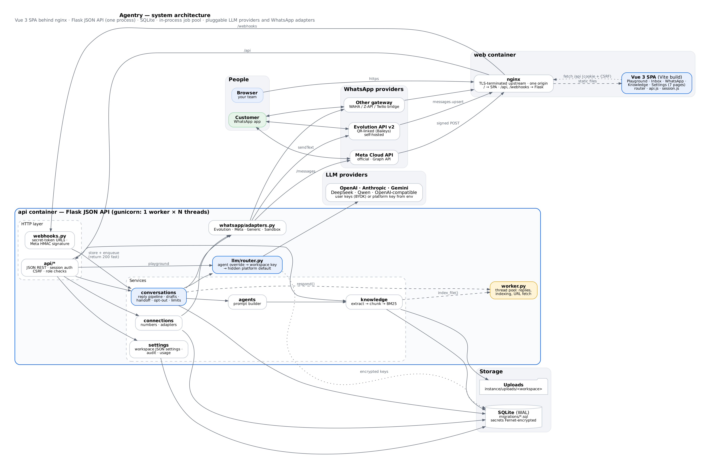
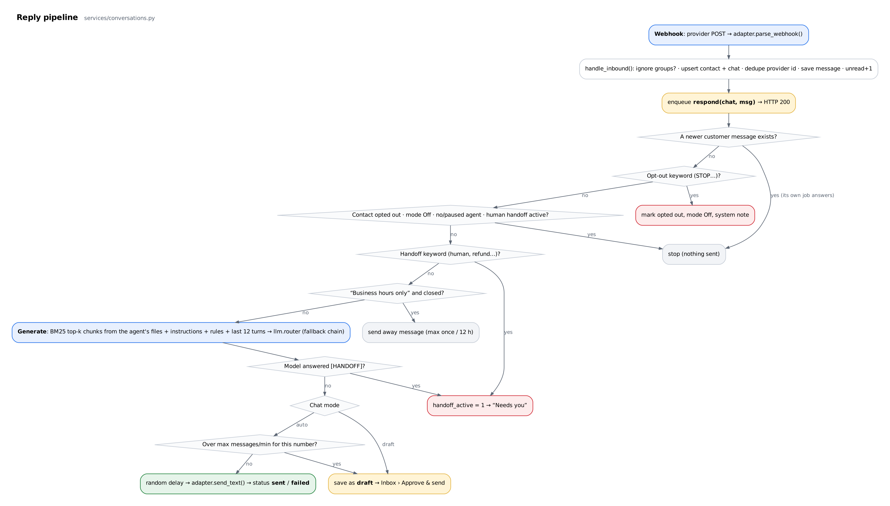

# Architecture


(Source: `architecture.dot`. Regenerate with the command at the top of that file.)

## 1. The system in one paragraph

The team uses a **Vue 3 single-page app** (`frontend/`), served as static files by **nginx**. nginx also
forwards `/api/*` and `/webhooks/*` to a **Flask JSON API** (`app/`), so everything shares one origin.
Flask serves two surfaces and no HTML: the **JSON API** the Vue app calls (`app/api/*`) and the
**webhooks** WhatsApp providers call (`webhooks.py`).
Business logic lives in `app/services/*`. Anything slow (LLM replies, document indexing, fetching a
web page) is handed to an **in-process thread pool** (`worker.py`) so HTTP requests return fast.
Data is in **SQLite**. Secrets are encrypted with **Fernet**. Two plug-in seams keep vendors swappable:
`llm/providers.py` (model APIs) and `whatsapp/adapters.py` (WhatsApp transports).

## 2. Components

| Component | Responsibility | Key file(s) |
|---|---|---|
| Vue app | Router + auth guard, API client, 11 screens, shared components, dark/light tokens | `frontend/src/` (see frontend/README.md) |
| nginx | Serves `frontend/dist`, SPA fallback to `index.html`, proxies `/api` `/webhooks` `/healthz` to Flask | `frontend/nginx.conf` |
| App factory | Config, migrations at boot, auth hook, CSRF, security headers, blueprints, CLI. JSON-only errors | `app/__init__.py` |
| JSON API | Validation, role checks, workspace scoping; thin, delegates to services | `app/api/*.py` |
| Webhooks | Authenticate provider, parse, store, enqueue, return 200 | `app/webhooks.py` |
| Conversations | **The reply pipeline**: rules, generate, send/draft, inbox actions | `app/services/conversations.py` |
| Agents | Agent CRUD helpers + **prompt builder** (instructions + rules + sources + history) | `app/services/agents.py` |
| Knowledge | Upload → extract → chunk → store; BM25 search | `app/services/knowledge.py`, `app/knowledge/*` |
| Connections | WhatsApp numbers, encrypted provider config, adapter factory | `app/services/connections.py` |
| LLM router | Pick the model (agent → workspace → platform), fallback, usage | `app/llm/router.py` |
| LLM providers | HTTP clients for OpenAI-shape, Anthropic, Gemini, Mock (tests only) | `app/llm/providers.py` |
| WhatsApp adapters | Evolution v2, Meta Cloud, Generic, Sandbox (tests only) | `app/whatsapp/adapters.py` |
| Worker | `enqueue(fn, *args)`: thread pool or inline (tests) | `app/worker.py` |
| Settings | Typed defaults for workspace JSON settings, audit log, usage | `app/services/settings.py` |
| Database | Connection per request/thread, helpers, migration runner | `app/db.py`, `app/migrations/` |

## 3. Key flows

### 3.1 Inbound WhatsApp message → reply


1. Provider POSTs to `/webhooks/<provider>/<conn_id>/<token>` (Meta: `/webhooks/meta/<conn_id>` with an HMAC signature).
2. The adapter turns the payload into `Inbound` / `ConnectionUpdate` events.
3. `handle_inbound()` upserts the contact and chat, **dedupes** on the provider message id (a unique index), stores the message, and enqueues `respond()`. The webhook returns 200.
4. `respond()` (worker thread) runs the checks in the diagram. If a newer customer message arrived meanwhile, it exits, because that message's own job answers the whole thread.
5. **Generate**: `agents.build_messages()` retrieves the top-k chunks from **files assigned to that agent**, builds the system prompt (agent instructions, safety/handoff rules, sources in `<source>` tags) and adds the last 12 turns. `router.generate()` calls the first working model.
6. In **draft** mode the reply is saved as `status='draft'`, and a person approves it in the Inbox. In **auto** mode it waits a random human-like delay, sends through the adapter, and stores `sent` or `failed`.

### 3.2 Model selection (`llm/router.py`)
```
candidates = [agent.model_override?] + [workspace BYOK model if source=byok] + [platform default if source=platform or fallback on]
first candidate that doesn't raise LLMError wins → usage recorded (platform_tokens | byok_tokens)
```
The platform default's provider, model and key come from env vars and are **never serialized**:
results from it are relabelled `provider="platform", model="default"`.

### 3.3 Knowledge indexing
Upload → file saved to `UPLOAD_DIR/<workspace>/` → row `status=pending` → worker `index_file()`
→ `extract()` gives `(locator, text)` sections (PDF pages, DOCX headings/tables, XLSX sheets) →
`chunk_sections()` (~900 chars, 120 overlap) → replace rows in `chunks` → `status=ready` (or
`failed` with a human-readable error, e.g. scanned PDF). Re-indexing is idempotent.

### 3.4 Browser ↔ API
1. The browser loads `index.html` + JS bundle from nginx. Vue Router's guard calls `GET /api/me`.
   A 401 means not signed in, so the guard redirects to `/login`.
2. `POST /api/auth/login` sets the session cookie (HttpOnly, SameSite=Lax). `GET /api/me` returns the
   user, the workspace and a **CSRF token**, which `api.js` keeps in memory and sends as `X-CSRF-Token`
   on every non-GET call.
3. Any later 401 (session expired) triggers `setUnauthorizedHandler` → redirect to `/login?next=…`.
4. The Inbox polls every 5 s and the sidebar every 30 s (no websockets; see MAINTENANCE.md).

Same-origin is deliberate: no CORS configuration and no tokens in localStorage. In development the
Vite dev server's proxy plays nginx's role (`frontend/vite.config.js`).

## 4. Multi-tenancy
Every tenant row has `workspace_id`. Every API handler reads `g.workspace_id` (from the logged-in
user) and filters by it, and child objects are always looked up *joined to* their workspace. A
user belongs to exactly one workspace. Test: `tests/test_auth_and_permissions.py::test_workspaces_are_isolated`.

## 5. Roles
`viewer < supervisor < admin < owner`, enforced by `@role_required(...)` on every API route.

| Role | Can |
|---|---|
| viewer | read everything except audit log/export |
| supervisor | + Playground, Inbox actions (approve, reply, take over, change agent/mode/rules), Knowledge uploads |
| admin | + agents, numbers, API keys, all settings, team, audit, export |
| owner | + delete workspace; role can't be changed or removed |

## 6. Design decisions (and why)

| Decision | Why | Revisit when |
|---|---|---|
| Vue 3 SPA + Flask JSON API, same origin via nginx | Clean frontend/backend split, independently deployable; same-origin keeps cookie auth + CSRF simple (no CORS, no JWT) | API consumed by third parties → add token auth alongside the session |
| No state library (Pinia), no UI kit | 11 screens with mostly page-local state; `session.js` + `signals` cover shared state. Design tokens in one CSS file | Shared state grows across many pages → add Pinia |
| SQLite (WAL) + plain SQL, no ORM | Zero ops, fast for one server; SQL is portable | Multiple app servers or more than ~50 writes/s → Postgres (MAINTENANCE.md) |
| In-process thread pool | No Redis/Celery to run; webhooks still return fast | More than one gunicorn worker or server → RQ/Celery |
| BM25 instead of embeddings | Offline, deterministic, works for EN/ES/ZH FAQs, no vector DB | Large or paraphrase-heavy corpora → embeddings + pgvector |
| Adapter + provider interfaces | WhatsApp transports and LLM vendors change often | Adding one = one class (MAINTENANCE.md) |
| Drafts are messages with `status='draft'` | Approve = update in place; history and stats stay simple | — |
| Platform default from env only | Can't leak through the UI/API; rotate by redeploying | Per-plan models → move to an admin-only table |
